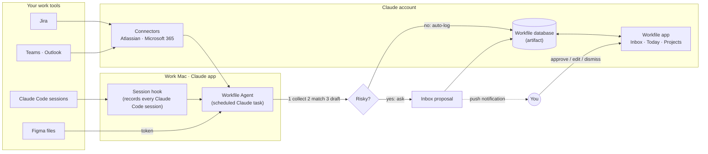

# Workfile Autopilot: plan

**Goal:** Workfile should keep itself up to date. You do the work in your usual tools (Claude Code, Figma, Jira, Teams, Outlook). Workfile watches them, writes the log for you, and only interrupts you when something deserves a decision.

Today Workfile is manual: you remember to log. This plan turns it into an assistant that captures, matches, drafts and asks.

---

## 1. Principles

1. **Capture where the work happens.** Never ask you to retype what a tool already knows.
2. **Read-only on work tools.** Workfile never moves a Jira ticket, edits a Figma file or messages anyone on its own. When an action is useful (book focus time, nudge a PM), it prepares it and you press send. The one exception is the **weekly report** you set up: it goes to the person you chose, after your OK unless you switch that off.
3. **Small things log themselves; consequential things ask first.** A prototype session note can log itself. Moving a project to Review, changing progress or creating a project waits for your OK.
4. **Everything is traceable and undoable.** Every automatic entry shows where it came from ("via Claude Code · enrollment-proto") and has Undo.
5. **One approval teaches it.** When you tell Workfile that a folder, Figma file or Jira epic belongs to a project, it remembers.
6. **Work data stays in the work account.** SOTI's Teams, Outlook and Jira are only read from the company Claude account on the work Mac.

---

## 2. What it watches

| Source | What it reads | What it turns into | How it connects | Default | Phase |
| --- | --- | --- | --- | --- | --- |
| **Claude Code** | Your prototyping sessions: what you asked for, what changed, git commits | A dated progress update on the right project, new links (preview URLs, PRs), done requirements | Workfile Agent plugin on the Mac (session hook + transcript) | Auto-log | 1 |
| **Figma** | Files linked to a project: named versions, new comments, last edit | Milestones ("v3 handoff ready"), feedback updates, "file edited but nothing logged" nudges | Figma access token in the macOS Keychain (Figma's own connector reads designs, not history) | Auto-log | 2 |
| **Jira** | Issues assigned to you, issues linked to projects: new assignments, status changes, comments, due dates | New-project or requirement suggestions, status-change updates, feedback, deadline warnings | Claude's **Atlassian** connector | Auto-log (new assignments ask) | 2 |
| **Outlook calendar** | Meetings whose title or attendees match a project | Morning prep list, "log the outcome of today's design review?" follow-ups, focus-time suggestions | Claude's **Microsoft 365** connector | Ask first | 3 |
| **Teams** | Chats and channels mentioning your projects or written to you | Asks ("specs by Friday?") as tasks, decisions, stakeholder feedback | Claude's **Microsoft 365** connector (`chat_message_search`) | Always ask | 3 |
| **Outlook mail** | Threads about your projects | Decisions, approvals, feedback | Claude's **Microsoft 365** connector | Always ask | 3 |
| **Claude chat** | (no outside access to chat history) | Use "log this to Workfile" inside a Claude Code or desktop session instead | Manual | Manual | — |

Verified on this machine: the Microsoft 365 connector exposes Outlook mail and calendar search, Teams chat search and SharePoint; it is read-only. The Atlassian connector exposes Jira read and write; Workfile will only use the read tools.

---

## 3. How it works

There are three parts.

1. **The Workfile app** (the artifact you already have) stays the memory. It gains an **Inbox** of proposals to approve, a **Connections** page to switch each source on and choose how much it may do alone, and a **Tracking** section on each project that says what belongs to it.
2. **The Workfile Agent** is a Claude Code plugin installed on your Mac. It is the engine. A small hook records every Claude Code session as it happens; a scheduled Claude task wakes up, reads what's new from each connected source, matches it to projects, drafts entries, applies the safe ones and files the rest in your Inbox.
3. **Connectors** are the plugs. Each one is a short instruction file the agent follows (what to read, what it may propose, how risky it is). Claude Code needs nothing extra. Jira, Teams and Outlook use connectors you enable in the company Claude account. Figma uses a personal access token.

**Why the agent runs on your Mac.** The Workfile database can only be written by the page itself or by Claude. There is no inbox for webhooks, so a scheduled Claude task is what does the work. Claude Code transcripts are local files, so that task has to run where you code. Cloud SaaS sources (Jira, Microsoft 365) could later move to a cloud routine that runs while the laptop sleeps.

**Schedule (weekdays, local time)**

| When | What |
| --- | --- |
| 08:45 | Morning brief: due soon, today's meetings per project, new Jira work, what went quiet. Shown on Today and sent as a notification. |
| Every hour, 09:00–18:00 | Sync: collect, match, log or ask. |
| 17:30 | End-of-day digest: "Logged 6 things today, 2 need your OK." |
| Your chosen day and time (weekly) | **Weekly report** of the last 7 days, sent to one person on Teams. See section 6. |

Scheduled tasks run while the Claude app is open; if the Mac was off, they catch up when it opens.

---

## 4. When it logs alone, and when it asks

Every captured item becomes a **proposal**. A proposal has a source, the project it matched (with a confidence score), a short summary in your voice, and one or more actions (log an update, add a link, mark a requirement done, create a project…). The policy decides what happens next.

| Risk | Examples | What happens |
| --- | --- | --- |
| **Low** (additive, reversible) | Session notes from Claude Code, a Figma named version, a Jira comment on a linked ticket, a new Figma or PR link, a meeting that happened | **Logged automatically** with its source. Listed under Inbox › Auto-logged with Undo, and in the 17:30 digest. |
| **Medium** (changes the project) | Progress change, stage change, requirement marked done, new project, anything matched with low confidence | **Waits in your Inbox.** One click approves; you can edit the text, pick another project or untick parts first. |
| **High** (time-sensitive or sensitive) | Newly assigned Jira ticket with a due date, a due date moved, a blocker, an ask from a stakeholder in Teams, anything from email | **Waits in your Inbox and sends a push notification** (desktop, and your phone if Remote Control is on). |

Each connector has a mode on the Connections page: **Off**, **Ask me first** (everything waits) or **Log automatically** (low risk logs itself, the rest still asks). Teams and email are always "Ask me first".

**Learning.** When a proposal has no project ("a session in `~/code/kiosk-proto`"), you pick the project once. Workfile saves that folder as the project's anchor, and every later session there matches on its own.

---

## 5. What the system takes off your plate

- **Morning brief.** What's due, which meetings today touch which project, new Jira work, what has gone quiet, one suggested focus.
- **Session write-ups.** After a Claude Code prototyping session, a two-line update appears on the right project.
- **Meeting follow-ups.** After "Enrollment design review" ends, a prompt to log the outcome, pre-filled with the project and attendees.
- **Work intake.** A PM assigns DES-142: Workfile proposes a project (or a requirement on an existing one) with the due date, and a task.
- **Asks become tasks.** "Can you share the empty-state specs by Friday?" in Teams becomes a proposed task with that date.
- **Honest stale nudges.** "Admin search has no update in 16 days, but its Figma file changed yesterday. Log what changed?"
- **Deadline risk.** Progress against due date, flagged before it slips.
- **Weekly report.** Written from your log on the day you choose and sent to one person on Teams (section 6). Goal evidence is collected all year for the self-review.
- **Focus time.** Suggested blocks based on free time in your calendar, opened as a pre-filled Outlook event that you save. The Microsoft 365 connector is read-only, so Workfile never books on its own.

---

## 6. Weekly report on Teams

On a weekday and time you pick (Connections › Weekly report), the agent writes a report of the last 7 days from your log: highlights, progress per project, blockers and asks, next week. It's under 300 words, in your voice, and only states what's in Workfile.

**Getting it to the person.** Claude's Microsoft 365 connector is read-only, so it can't post in Teams by itself. Two ways around that, both under your control:

| | How it reaches them | Setup |
| --- | --- | --- |
| **Pre-filled chat** (works now) | The draft lands in your Inbox. "Open Teams chat with Priya" opens Teams with the report typed in; you press send and mark it sent. | Their work email in Connections › Weekly report. |
| **Teams workflow** (fully automatic) | You approve in the Inbox (or choose "Send without asking"); the agent posts it to your chat with that person through a Teams Workflows webhook. It appears from the Workflows app. | In Teams › Workflows, template "Send webhook alerts to a chat", pick the chat, copy the URL into your Keychain (`security add-generic-password -a "$USER" -s workfile-teams-webhook -w`). About two minutes, no IT app registration. Check with IT that Workflows is allowed. |

Every report is saved in Journal › Weekly reports, where you can edit it before it goes out.

---

## 7. Matching work to projects

Each project gets **anchors** (Project › Tracking):

- **Folders and repos** where you prototype with Claude Code.
- **Figma files**, taken automatically from the project's design and prototype links.
- **Jira keys**: epics or issues, plus any Jira links on the project.
- **Keywords**: names people use for it in meetings and chat ("enrollment", "DEP").
- **Channels**: Teams chats or channels that are about this project.

The agent matches on anchors first (exact, confident), then on meaning (Claude reads the item against project titles, briefs and keywords and gives a confidence). Below 0.7 confidence, the proposal always asks.

---

## 8. Data model additions

All additive, so existing data keeps working (see `CLAUDE.md` › Updating the app safely).

| Where | Addition |
| --- | --- |
| `updates/{id}` | `source: { kind, ref, url, label }` (manual by default) and `proposalId` |
| `projects/{id}` | `anchors: { repos[], jiraKeys[], keywords[], channels[] }` |
| `inbox/{id}` (new) | A proposal: `source`, `title`, `summary`, `why`, `projectId`, `confidence`, `actions[]`, `risk`, `status` (pending · approved · dismissed · auto), `applied` (for Undo) |
| `connectors/{id}` (new) | `mode` (off · ask · auto), `lastRunAt`, `lastStatus`, `lastMessage`, `cursor`, `ignore[]` |
| `meta/brief` (new) | The latest morning brief (Markdown) shown on Today |
| `reports/{id}` (new) | A weekly report: period, Markdown body, recipient, status (draft · approved · sent · failed) |
| `meta/settings.report` | Weekly report day, time, recipient and delivery (ask first, or send without asking) |

Proposal ids are deterministic (`x_<source>_<external id>`), so a re-run never files the same thing twice.

---

## 9. Personal laptop and work Mac

| | Personal laptop (now) | Work Mac |
| --- | --- | --- |
| Claude account | Personal | SOTI company account |
| Workfile artifact | Personal artifact | Company artifact (import your export) |
| Claude Code connector | Yes | Yes |
| Figma | Optional (personal files) | Yes, with a token if SOTI allows Figma personal access tokens |
| Jira, Teams, Outlook | **No.** Keep SOTI data out of the personal account | Yes, once SOTI's Claude admin enables the Atlassian and Microsoft 365 connectors |

The agent reads its machine settings (which artifact to write to, which folders to ignore) from `~/.workfile/config.json`, so the same plugin works on both machines.

**Before switching on work sources, check with SOTI IT:** that the Atlassian and Microsoft 365 connectors are approved for the company Claude org, and whether Figma personal access tokens are allowed.

---

## 10. Plugging in a tool

**On the work Mac (no code):**

1. Install the agent plugin. Ask Claude Code to install the Workfile Agent from `github.com/aniketsompura/personal_assistant`, or in Terminal: `claude plugin marketplace add aniketsompura/personal_assistant`, then `claude plugin install workfile-agent@workfile`.
2. Run `/workfile-agent:workfile-setup`. It writes `~/.workfile/config.json` with your company artifact link and creates the scheduled tasks (hourly sync, morning brief, weekly report).
3. In claude.ai › Settings › Connectors, connect **Atlassian** and **Microsoft 365** (company account).
4. In Workfile › Connections, switch each source on and pick its mode.

**Adding a new kind of tool (developer):**

1. Add an entry to `src/connectors/registry.ts` (name, what it reads, how it connects, default mode). It appears on the Connections page.
2. Add `agent/connectors/<id>.md`: what to read, which tools to call, how to turn findings into proposals, risk rules, and the id scheme for de-duplication.
3. If the tool has no Claude connector, add a small read-only script in `agent/scripts/` that prints JSON.

---

## 11. Roadmap

| Phase | Scope | Status |
| --- | --- | --- |
| **0. The plug** | Inbox with approve / edit / dismiss / undo; Connections page; project anchors; source on every update; morning brief on Today; weekly report (settings, drafts, Teams hand-off); the agent plugin with the session hook, sync, brief, report and log skills, connector instructions and scripts | Built in this branch |
| **1. Claude Code autopilot** | Install the plugin, schedule the hourly sync and digests, push notifications for high-risk items | Needs your OK to install hooks and scheduled tasks on this laptop |
| **2. Figma + Jira** | Figma versions and comments (token), Jira intake and ticket tracking | Work Mac, after IT check |
| **3. Microsoft 365** | Calendar follow-ups and prep, Teams and mail asks, focus-time suggestions | Work Mac, after IT check |
| **4. Smarter planning** | Deadline forecasting, workload view across projects, optional cloud routine so syncing continues while the Mac sleeps, optional in-page "Sync now" using the connectors directly | Later |

---

## 12. Limits to know

- **Not instant.** Sources are checked on a schedule (hourly), not in real time. Fine for a work log; not a chat client.
- **The Mac has to be on, with the Claude app open,** for scheduled syncs. Missed runs catch up on launch.
- **Claude chat can't be read from outside.** Prototype in Claude Code (captured), or ask Claude to log a chat's outcome to Workfile.
- **Teams and mail are search-based.** The connector searches; it doesn't subscribe. Keywords and channels on each project make it reliable.
- **Every run uses Claude usage.** The agent reads only what changed since the last run and stays quiet when nothing did.
- **Matching can be wrong.** That's why changes ask first, low-confidence items always ask, and everything has Undo.

## 13. Decisions for you

1. OK to install the agent plugin (adds a session hook to Claude Code) and the scheduled tasks on this laptop for the Claude Code connector?
2. Sync hours: hourly 09:00–18:00 on weekdays, or less often?
3. Push notifications for high-risk items only (recommended), or also the daily digest?
4. Weekly report: which day and time, and who receives it? Start with "Ask me first" for a few weeks before "Send without asking".
